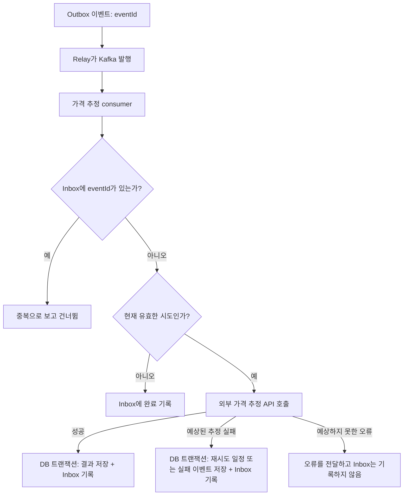

가격 추정 Kafka consumer가 같은 이벤트를 다시 받아도, 이미 처리 완료한 `eventId`라면 로컬 DB 처리를 반복하지 않도록 Inbox를 적용했다.

## 왜 필요한가

Kafka consumer는 업무 처리가 끝난 뒤 offset을 기록한다. 업무 DB 반영 직후 offset 기록 전에 consumer가 죽으면 Kafka가 같은 메시지를 다시 전달할 수 있다. 이를 재전달(redelivery)이라고 한다.

Inbox는 consumer가 처리 완료한 이벤트 ID를 DB에 보관한다. 같은 ID가 다시 오면 완료 기록을 확인하고 건너뛴다. 이 구현은 **가격 추정 요청 consumer에만** 적용했다.

## 현재 처리 흐름

1. Inbox에 같은 `eventId`가 있으면 처리하지 않고 반환한다.
2. 가격 요청이 현재 유효한 시도가 아니면 외부 API를 부르지 않고 Inbox에 기록한다.
3. 유효한 요청이면 외부 가격 추정 API를 호출한다.
4. 성공하면 가격 결과와 Inbox 완료 기록을 같은 DB 트랜잭션으로 저장한다.
5. 분류된 가격 추정 실패는 재시도 일정 또는 최종 실패 이벤트를 저장하면서 Inbox에도 기록한다. 다음 재시도는 새 `eventId`를 쓰므로 새 메시지로 처리된다.
6. 예상하지 못한 오류나 DB 오류가 나면 Inbox 완료 기록이 커밋되지 않는다. listener가 오류를 다시 던져 Kafka 재처리 경로로 넘긴다.

## 바뀐 코드

- `src/main/java/com/example/KTB_Agile_backend/item/price/application/ItemPriceEstimationProcessor.java` — Inbox 조회, 중복 건너뛰기, 결과·실패 상태와 완료 기록의 트랜잭션 경계
- `src/main/java/com/example/KTB_Agile_backend/item/price/persistence/ItemPriceEstimationInboxRepository.java` — Inbox 조회와 완료 ID 저장
- `src/main/resources/db/migration/V32__create_item_price_estimation_inbox.sql` — `event_id`를 기본 키로 갖는 Inbox 테이블

## 보장하는 것

가격 결과 반영이나 재시도 일정 저장과 Inbox 기록이 한 DB 트랜잭션에서 함께 커밋된다. 따라서 DB 처리가 커밋된 뒤 Kafka 메시지가 다시 전달되면 같은 `eventId`를 보고 DB 처리를 건너뛴다.

가격 추정 재시도는 새 `eventId`를 발급한다. Inbox가 구분하는 단위는 논리적인 `requestId`가 아니라 **개별 Kafka 이벤트 ID**다.

## 단점과 한계

- **DB 작업과 저장 공간이 늘어난다.** 이벤트마다 Inbox 조회와 완료 기록이 추가된다. 처리량이 커지면 테이블도 계속 커지므로 보관 기간과 정리 정책이 필요하다. 너무 일찍 지우면 오래된 Kafka 재생이나 수동 재처리에서 중복을 다시 처리할 수 있다.
- **외부 API를 정확히 한 번만 호출한다고 보장하지 않는다.** 가격 추정 API와 로컬 DB는 하나의 트랜잭션으로 묶을 수 없다. API 응답을 받은 뒤 결과와 Inbox를 DB에 커밋하기 전에 장애가 나면, 재전달된 이벤트에서 API를 다시 부를 수 있다.
- **동시 중복 호출을 막는 선점 상태는 없다.** Inbox 조회 후 완료 기록 전까지 같은 ID가 동시에 처리되면 두 consumer가 모두 조회를 통과해 외부 API를 각각 호출할 수 있다. 현재 가격 결과 반영은 요청 상태와 DB 잠금으로 보호하지만, 외부 호출 중복까지 막지는 않는다. 이를 막으려면 `PROCESSING` 상태와 만료 시간(lease)을 둔 claim이 추가로 필요하다.
- **같은 ID로 수동 재처리하면 건너뛴다.** 강제 재처리 절차가 필요하면 Inbox 기록 삭제 또는 명시적인 재처리 기능이 필요하다. 새 ID만 발급해도 가격 요청 상태가 이미 완료됐다면 현재 시도 검사에서 걸러질 수 있다.
- **마이그레이션이 선행되어야 한다.** `V32`로 Inbox 테이블을 만든 뒤 애플리케이션을 배포해야 한다. 테이블이 없으면 consumer가 Inbox 조회 시 실패한다.

## 설명할 때 이렇게 말하기

> Outbox는 producer가 업무 데이터와 이벤트를 같이 저장해 발행 누락을 막고, Inbox는 consumer가 이미 처리한 이벤트 ID를 기억해 재전달에 따른 DB 중복 반영을 막습니다. 이번에는 가격 추정 consumer만 적용했습니다. 결과 또는 재시도 상태와 Inbox 기록은 같은 DB 트랜잭션으로 저장하지만, 외부 가격 추정 API와 DB까지 원자적으로 묶을 수는 없어서 장애 시 외부 API가 다시 호출될 가능성은 남습니다.

## 확인 상태

이번 문서화 시점에는 테스트와 빌드를 실행하지 않았다.
